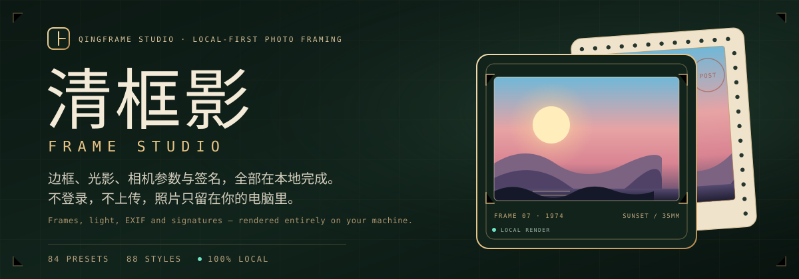
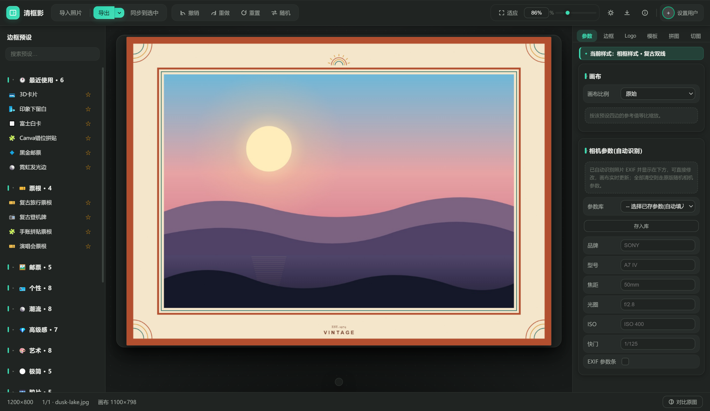
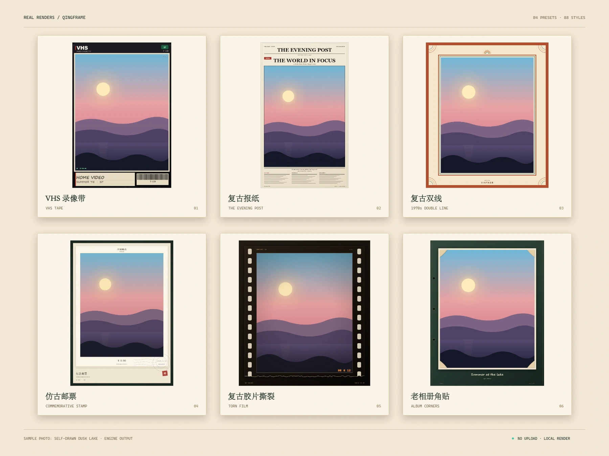

<p align="center">
  
</p>

<p align="center">
  <strong>给照片一副好框，给参数一个位置。</strong><br>
  本地优先的桌面照片加框工具：艺术边框、光影、Logo 水印、EXIF 与签名，一次完成。
</p>

<p align="center">
  <sub>A local-first desktop photo framing app. Frames, light, logos, EXIF and signatures — rendered entirely on your machine.</sub>
</p>

<p align="center">
  <a href="https://github.com/lumos-1s/Qing-Fram-Shadow-web/stargazers"></a>
  <a href="./LICENSE"></a>
  <a href="https://github.com/lumos-1s/Qing-Fram-Shadow-web/releases"></a>
  <a href="https://www.electronjs.org/"></a>
  
</p>

---

## 先看效果 · See it in action

<p align="center">
  
</p>

<p align="center">
  <sub>真实应用界面 · 套用「复古双线」预设 · 示例照片与参数为演示数据<br>Real UI with the “1970s Double Line” preset · demo photo and data</sub>
</p>

## 它是什么 · What it is

**清框影 QingFramShadow** 是一款 Windows 桌面照片加框工具。它把「边框」当成一张可编辑的画布：先选一个模板定下气质，再调整边距、圆角、纹理、光影、Logo、相机参数与签名，最后按原图尺寸或指定尺寸导出。

- **想让照片快速成片的人**：87 个模板直接套用，右侧参数实时预览。
- **在意画质与隐私的人**：Canvas 2D 本地渲染，照片不上传，不登录。
- **需要成批出图的人**：模板记忆、批量导入、同步到选中，一次导出。

> **English** — A Windows desktop app for framing photos locally: 87 presets, 92 frame styles, live frame/light/logo/EXIF controls, reusable templates, collage, grid slicing and batch export. No account, no uploads.

<a id="download"></a>
## 下载 · Download

从 [GitHub Releases](https://github.com/lumos-1s/Qing-Fram-Shadow-web/releases) 下载 Windows 安装版（NSIS）或便携版。

**当前 Windows 产物未签名。** 安装包由 GitHub Actions 从本仓库构建；首次运行会遇到 SmartScreen「未知发布者」提示，处理方式见下方[安装提示](#smart-screen)，校验方式见[代码签名政策](./CODE_SIGNING.md)。

> **English** — Windows builds are currently unsigned (SmartScreen will warn on first run). They are built by GitHub Actions from this repository. See [code signing policy](./CODE_SIGNING.md).

<a id="smart-screen"></a>
### 提示「未知发布者」怎么办 · SmartScreen note

未签名软件首次运行会被 SmartScreen 拦截，这是预期行为，不代表文件被篡改：

1. 在蓝色提示框点「更多信息 / More info」。
2. 点「仍要运行 / Run anyway」，再在 UAC 里点「是 / Yes」。
3. 不放心就先核对文件校验值（`certutil -hashfile <安装包> SHA256`），或改用免安装的便携版。

## 核心功能 · Features

- **87 个内置模板 · 92 种边框风格** — 杂志、拍立得、撕纸、胶带、邮票、报纸、胶片、渐变卡、漫画分镜、3D 卡、签名纪念与头像叠加，以及自动取色边框等快速预设；选中即套用，再继续微调。
- **参数实时可调** — 圆角、边距、照片缩放/偏移、内/外阴影、描边、投影、画布比例、纹理/渐变填充，改动即时反馈。
- **光影与质感** — 暗角、漏光、暖光/冷光、胶片颗粒，以及纸张、布料等纹理，给整张成片统一的氛围。
- **Logo、EXIF 与签名** — 品牌 Logo 或自定义图标水印；自动读取品牌、型号、焦距、光圈、ISO、快门，可手动修改；签名与头像组合排版。
- **模板系统** — 保存/导入/导出 `.qfs` 工程与 `.json`；支持搜索、标签分组、缩略图预览、应用、重命名与带确认的删除。
- **拼图与九宫格** — 多图网格拼贴，间距、圆角与字幕可调；九宫格切图把当前画布按 n×n 切成多张，预览确认后导出。
- **批量处理** — 批量导入（支持整个文件夹与 HEIC，HEIC 自动读取 EXIF）、逐张记忆模板、同步到选中、装框缩略图，一键批量导出。
- **导出** — PNG / JPEG / WebP，质量可调；原图、1080、2048、4096、8192px；选好位置后渲染写入，默认原图尺寸。
- **全本地** — 无需登录、不上传照片；照片、EXIF 与模板都留在本机。

> **English** — 87 presets and 92 frame styles for magazine, polaroid, torn paper, tape, stamp, newspaper, film, gradient, comic, 3D card, signature and avatar layouts; live frame, shadow, texture and light controls; logo/EXIF/signature layers; `.qfs` and `.json` templates; collage, grid slicing and batch export; PNG/JPEG/WebP up to 8192px. Everything local.

## 预设效果 · Preset Gallery

<p align="center">
  
</p>

<p align="center">
  <sub>六种预设的真实渲染 · 示例照片为项目自绘的黄昏湖面<br>Six real engine renders · sample photo: a self-drawn dusk lake</sub>
</p>

87 个模板覆盖复古胶片、拍立得、邮票、报纸、杂志、撕纸、胶带、漫画、签名、拼图等方向；每个模板都能继续改边距、圆角、纹理、光影与文字。六张预设图都由引擎实际渲染，不是手工绘制的模拟效果，也没有使用图库或用户照片。

## 快速开始 · Quick Start

**直接使用**：从 [Releases](https://github.com/lumos-1s/Qing-Fram-Shadow-web/releases) 下载 Windows 安装版或便携版。

**三步出片**：

1. 打开应用，导入一张或多张照片。
2. 在左侧选一个模板，在右侧调整边框、光影、Logo、EXIF 与签名。
3. 点「导出」，选择 PNG / JPEG / WebP 与导出尺寸。

> **English** — Download a Windows build from Releases, import photos, pick a preset, adjust the frame/light/logo/EXIF, then export as PNG, JPEG or WebP.

**从源码运行**：

```bash
# 安装依赖 / install dependencies
npm install

# 开发模式启动 / run in dev mode
npm run start

# 打包 Windows 安装版 / build installers
npm run dist

# 仅供便携版 / portable only
npm run dist:portable
```

构建产物位于 `dist/`。Built artifacts are placed in `dist/`.

> 提示：Windows 上可双击根目录 `start.bat` 直接启动开发环境。
> Tip: on Windows you can double-click `start.bat` in the project root to launch the dev environment.

## 技术栈 · Tech Stack

[](https://skillicons.dev)

| 层 Layer | 技术 Tech |
|---|---|
| 桌面壳 Desktop shell | Electron 31（主/渲染进程分离，`contextIsolation` 开启） |
| 渲染 Rendering | 原生 HTML / CSS / JavaScript + Canvas 2D 离屏合成 |
| 打包分发 Packaging | electron-builder（NSIS 安装版 + 便携版） |
| 自动更新 Auto-update | electron-updater + GitHub Releases |

没有前端框架，也没有后端服务；边框、光影、文字与导出都在渲染进程的 Canvas 2D 里完成。

## 项目结构 · Project Structure

```
├─ src/
│  ├─ main/          # Electron 主进程：窗口、菜单、文件 IPC、模板读写
│  │                 #   main process: window, menus, file IPC, template I/O
│  └─ renderer/      # 渲染进程：UI 与 Canvas 渲染引擎
│                    #   renderer: UI and Canvas rendering engine
├─ shared/
│  ├─ presets/       # 87 个内置模板（JSON 描述）
│  │                 #   87 built-in preset templates (JSON)
│  ├─ textures/      # 纹理素材 / texture assets (10)
│  └─ brandlogos/    # 本机品牌 Logo 素材，不随发行版分发
│                    #   local-only brand logos, excluded from distribution
├─ assets/readme/    # README 头图、界面截图与预设效果墙
├─ tools/            # 构建、校验与 Electron 测试辅助脚本
├─ tests/            # 单元 / 视觉回归等测试
├─ start.bat         # Windows 快速启动脚本 / quick-launch script
├─ THIRD-PARTY-ASSETS.md  # 第三方素材归属说明 / asset attribution notice
└─ package.json
```

## 开发与校验 · Development

<details>
<summary><strong>发布前自检 · Pre-release checks</strong></summary>

```bash
npm run check         # ESLint + 预设/标记/能力表校验 + 主进程 I/O、图标、引擎不变量（纯 Node，不需要 GUI）
npm test              # check + Electron 用例（面板、拖动、视觉回归等；&& 串联，单点失败即断）
npm run release       # 未压缩目录 → verify:dist 校验 → 打安装包 → verify:pkg 校验安装包
```

`npm run release` 等价于 `app:dir` + `verify:dist` + `dist`（`dist` 内含安装包构建 + `verify:pkg`）。`verify:dist` 会拦截品牌 Logo 泄漏、预设/纹理数量与源码不符、以及产物早于源码改动的情况；一旦发现，不会继续产出安装包。

```bash
npm run app:dir       # 只产出未压缩目录（供校验用）
npm run verify:dist   # 检查 dist/ 下所有 app.asar：无品牌 Logo、预设/纹理数量与源码实测一致、产物新鲜
npm run verify:pkg    # 另加安装包核验：Setup.exe 体积与 latest.yml 一致 + sha512 校验和逐字节复核
```

`verify:dist` 的退出码：`0` 通过 / `1` 已确定的失败（品牌 Logo 泄漏、预设或纹理数量与源码不符、或没有任何可读产物）/ `2` 无法判定（仅产物早于源码改动这种拿不准的情况）。`verify:pkg`（`--installers` 模式）在此基础上核对安装包与 `latest.yml` 的 size/sha512，不一致即退出码 1——`dist` / `release` / `release:publish` 都已在链尾自动执行。

> 预设与纹理的期望数量从 `shared/` 实测，不写死在脚本里——加了预设就不必再改校验脚本。

</details>

## 代码签名政策 · Code signing policy

**Windows 产物目前未签名。** 本项目曾向 [SignPath Foundation](https://signpath.org/) 申请开源项目的免费代码签名；因项目公开可见度尚未达到该计划的门槛（其评审看的是 Star、Fork、外部引用与社区活跃度等公开信号），申请未获通过，达到条件后会重新申请。

在获得签名之前：

- GitHub Releases 上的安装包与便携版都是**未签名产物**，首次运行会出现 SmartScreen「未知发布者」提示；这是未签名软件的正常行为，处理方式见[安装提示](#smart-screen)。
- 请只从本仓库 Releases 页面下载，并按 [`CODE_SIGNING.md`](./CODE_SIGNING.md#verifying-an-unsigned-release) 核对校验值。
- **任何称清框影已由 SignPath Foundation 签名的说法，对当前版本都不成立。**

签名范围、审批流程与验签方法（签名启用后适用）见 [`CODE_SIGNING.md`](./CODE_SIGNING.md)；联网与隐私说明见 [`PRIVACY.md`](./PRIVACY.md)。

> **English** — Windows builds are unsigned for now. An application to the SignPath Foundation OSS program was declined because the project does not yet meet the program's public-visibility bar; the project will reapply. Do not describe any current release as signed. See [`CODE_SIGNING.md`](./CODE_SIGNING.md) for verification.

## 素材与许可 · Assets & License

代码采用 [MIT](./LICENSE) 许可。该许可仅覆盖 `src/` 下的源代码与 `shared/presets/` 中的原创模板；`shared/brandlogos/` 与 `shared/textures/` 中的素材不适用，其权利归各自权利人所有。

- **品牌 Logo**：`shared/brandlogos/` 是本机素材，**不在版本库中**，也不随安装包分发。全新克隆缺少该目录时软件照常运行，只是「品牌 Logo」选择组为空、「按品牌自动配 Logo」不生效；相关素材需自行准备。品牌名称与图形仅用于标识照片的拍摄设备，本软件与任何品牌无授权或合作关系。
- **纹理素材**：`shared/textures/` 中的纹理不适用 MIT 许可，权利归各自权利人所有。
- **README 示例图**：示例照片为项目自绘的合成图；界面截图与预设效果由真实应用渲染，未使用图库或用户照片。

详见 [`THIRD-PARTY-ASSETS.md`](./THIRD-PARTY-ASSETS.md)。

> **English** — MIT covers the source code under `src/` and the original presets under `shared/presets/`. Brand logos are local-only: not tracked by git and excluded from installers; a fresh clone runs fine without them. Assets under `shared/textures/` are third-party material. See `THIRD-PARTY-ASSETS.md`.

---

<sub>关键词 / Keywords：照片加边框 · 艺术边框 · 水印 · EXIF 相机参数 · 拼图 · 九宫格切图 · 批量导出 · 桌面工具 · Electron · Canvas 2D · photo frame · watermark · collage · grid slice · batch export</sub>

<p align="center"><sub>如果清框影对你有帮助，欢迎点一个 ⭐ Star。</sub></p>
