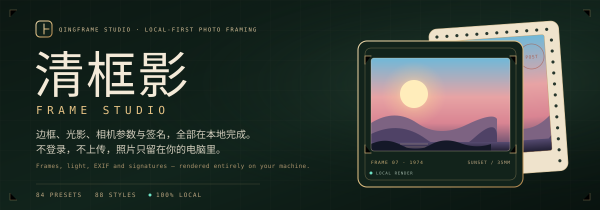
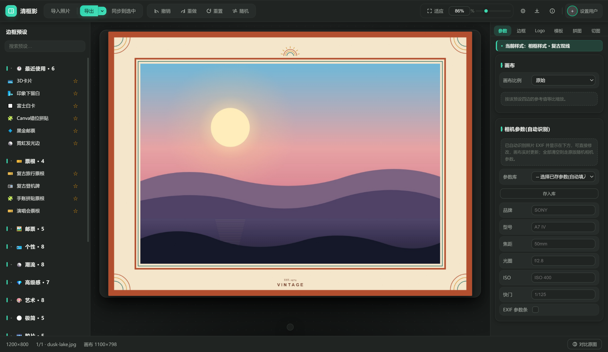
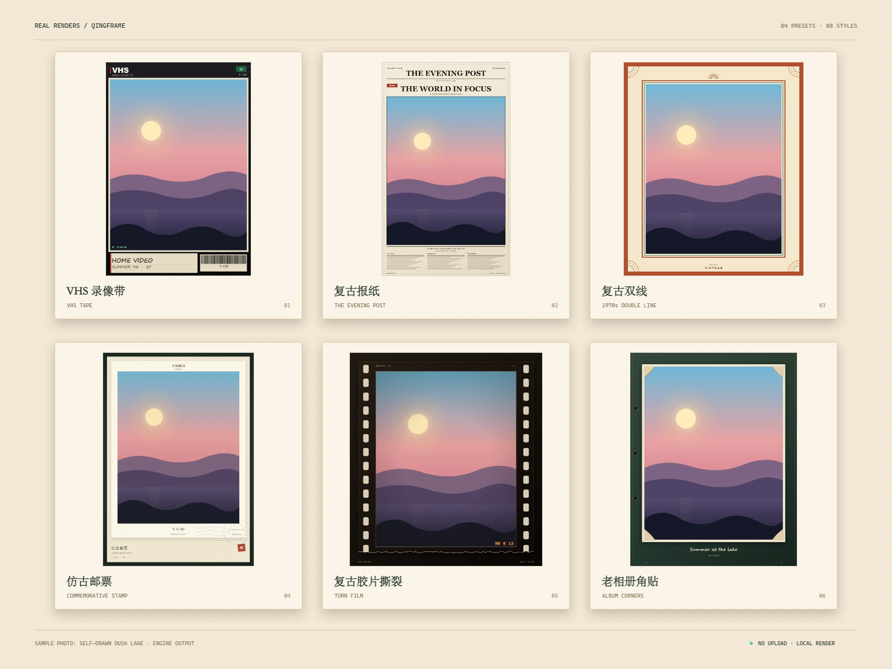

<a id="readme-top"></a>
<p align="center">
  
</p>

<p align="center">
  <strong>给照片一副好框，给参数一个位置。</strong><br>
  本地优先的桌面照片加框工具：边框、调色、RAW、水印、EXIF 与签名，一次完成。
</p>

<p align="center"><sub>
  A local-first Windows desktop app — 90 presets and 95 frame styles, live colour grading,
  RAW developing, watermarks and batch export. No account, no uploads.
</sub></p>

<p align="center">
  <a href="https://github.com/lumos-1s/Qing-Fram-Shadow/stargazers"></a>
  <a href="./LICENSE"></a>
  <a href="https://github.com/lumos-1s/Qing-Fram-Shadow/releases"></a>
  <a href="https://www.electronjs.org/"></a>
  
</p>

<details>
<summary><strong>目录 · Contents</strong></summary>

[下载](#download) · [界面](#screenshots) · [能做什么](#features) · [预设效果](#preset-gallery) · [最近更新](#whats-new) · [快速开始](#quick-start) · [技术栈](#tech-stack) · [项目结构](#project-structure) · [开发与校验](#development) · [签名与隐私](#code-signing) · [参与贡献](#contributing) · [素材与许可](#assets-license)

</details>

---

<a id="download"></a>
## 下载 · Download

**当前版本 v0.1.25** — 从 [GitHub Releases](https://github.com/lumos-1s/Qing-Fram-Shadow/releases) 获取 Windows 安装版（NSIS）或便携版。

> **English** — Grab the Windows installer or portable build from Releases. Everything is rendered on your machine; no account, no upload.

安装包由 GitHub Actions 从本仓库构建，**目前未签名**，首次运行会出现 SmartScreen「未知发布者」提示。这是未签名软件的正常行为，见[处理方式](#smart-screen)与[签名政策](./CODE_SIGNING.md)。

<details>
<summary><a id="smart-screen"></a><strong>SmartScreen 提示「未知发布者」怎么办</strong></summary>

1. 在蓝色提示框点「更多信息 / More info」。
2. 点「仍要运行 / Run anyway」，再在 UAC 里点「是 / Yes」。
3. 想先核对文件，运行 `certutil -hashfile <安装包> SHA256`，或改用免安装的便携版。

</details>

<a id="screenshots"></a>
## 先看效果 · See it in action

<p align="center">
  
</p>

<p align="center"><sub>真实应用界面 · 示例照片与参数为演示数据 / Real UI, demo photo and data</sub></p>

<a id="features"></a>
## 能做什么 · Features

| | |
|---|---|
| **90 款内置边框 · 95 种风格** | 杂志、拍立得、邮票、撕纸、胶片、渐变卡、3D 卡、水印与头像叠加；选中即套用，鼠标悬停先预览 |
| **调色** | 按 Camera Raw 分成「亮 / 颜色 / 效果」三段：直方图、曲线、混色器、校准、蒙版、黑白、锐化；每段可单独收起与复位 |
| **RAW 直读显影** | arw / cr2 / cr3 / nef / raf / dng 等三十余种，LibRaw 解码；先出 1600px 代理，切到照片后自动补到全尺寸，可裁切旋转 |
| **文字 · Logo · EXIF** | 品牌 Logo 与自定义图标、相机参数自动读取、签名与头像排版；文字可拖拽定位、改字号与颜色 |
| **我的调色** | 把调色存成 Lightroom 可读的 `.xmp`，批量导入、悬停预览、编组搜索、套用到选中或全部照片 |
| **成批出图** | 多图导入、逐张记忆样式、同步到选中、拼图与切图、沉浸照片墙、一键批量导出 |
| **导出** | PNG / JPEG / WebP，质量可调；原图尺寸或 1080 / 2048 / 4096 / 8192px |
| **全本地** | 无需登录、不上传照片；照片、EXIF 与样式都留在本机 |

> **English** — Live frame, light and logo controls; per-photo grading with curves, masks and XMP presets; collage, grid slicing, immersive presentation and batch export up to 8192px. Everything stays local.

<a id="preset-gallery"></a>
## 预设效果 · Preset Gallery

<p align="center">
  
</p>

<p align="center"><sub>六张预设均由引擎实际渲染 · 示例照片为项目自绘 / Six real engine renders, self-drawn sample photo</sub></p>

90 款边框覆盖复古胶片、拍立得、邮票、报纸、杂志、撕纸、胶带、漫画、签名与拼图等方向，每一款都能继续改边距、圆角、纹理、光影与文字。启动时也能直接进入封面墙，用方向键、滚轮或拖动浏览，点一下就进编辑。

<a id="whats-new"></a>
## 最近更新 · What's New

### v0.1.25 · 2026-11-09

- **RAW 直读与两级显影** — 三十余种 RAW 格式直接导入，代理秒开、切图自动补到全尺寸，不重复解码。
- **调色面板重排** — 直方图与 EXIF 钉在顶部，参数分「亮 / 颜色 / 效果」三段；曲线外框恒为正方形，端点可设黑白场。
- **界面减负** — 页签收成一行、低频档位默认收起、预设墙非全屏时顶部栏不再重叠。

完整变更与安装包见 [GitHub Releases](https://github.com/lumos-1s/Qing-Fram-Shadow/releases)；应用内「设置 → 关于 → 更新内容」也有离线版。

<a id="quick-start"></a>
## 快速开始 · Quick Start

**三步出片**：导入照片 → 从封面墙或左侧列表选边框 → 右侧调边距/调色/水印 → 点「导出」。

从源码运行：

```bash
npm install
npm run start:soft     # 开发启动（自动挑可用的 Electron）
npm run dist           # 打包 Windows 安装版 + 便携版
```

产物在 `dist/`。Windows 上也可以直接双击根目录 `start.bat`。开发启动优先用 `start:soft`；只有 GPU 进程崩溃时才换 `start:sw`（swiftshader 软件渲染，慢但兼容）。

> **English** — `npm install` → `npm run start:soft` → `npm run dist`. Artifacts land in `dist/`.

换封面照片：把图片按分类名放进 `design/preset-wall-samples/`，运行 `npm run gen:wall`；只想换单张，用应用内「换封面」按钮打开 `wall-covers/` 目录放入 `<预设名>.webp` 后重启。

<a id="tech-stack"></a>
## 技术栈 · Tech Stack

| 层 | 技术 |
|---|---|
| 桌面壳 | Electron 45（主/渲染分离，`contextIsolation` + `sandbox`） |
| 渲染 | 原生 HTML / CSS / JavaScript + Canvas 2D 离屏合成 |
| RAW 解码 | LibRaw（`libraw-wasm`，主进程独立线程；LGPL-2.1 / CDDL） |
| 打包分发 | electron-builder（NSIS + 便携版） |
| 自动更新 | electron-updater + GitHub Releases |

没有前端框架，也没有后端服务；边框、光影、文字与导出都在渲染进程的 Canvas 2D 里完成。

<a id="project-structure"></a>
## 项目结构 · Project Structure

```
├─ src/main/          # Electron 主进程：窗口、菜单、文件 IPC、模板读写
├─ src/renderer/      # 渲染进程：UI 与 Canvas 2D 渲染引擎
├─ shared/presets/    # 90 built-in preset templates (JSON)
├─ shared/textures/   # 纹理素材 / texture assets (10)
├─ assets/readme/     # README 头图、界面截图与预设效果墙
├─ tools/             # 构建、校验与 Electron 测试辅助脚本
├─ tests/             # 单元 / 视觉回归测试
└─ start.bat          # Windows 快速启动脚本
```

<a id="development"></a>
## 开发与校验 · Development

<details>
<summary><strong>发布前自检 · Pre-release checks</strong></summary>

```bash
npm run check         # ESLint + 预设/能力表计数 + 主进程 I/O、图标、引擎不变量（纯 Node）
npm run test:ci       # check + 全部 Electron GUI 用例
npm run release       # 未压缩目录 → verify:dist → 打安装包 → verify:pkg
```

`verify:dist` 会拦截品牌 Logo 泄漏、预设/纹理数量与源码不符、产物早于源码改动；`verify:pkg` 另核对安装包与 `latest.yml` 的 size/sha512。期望数量从 `shared/` 实测，不写死在脚本里。详细流程见 [RELEASE.md](./RELEASE.md)。

</details>

<a id="code-signing"></a>
## 签名与隐私 · Signing & Privacy

**Windows 产物目前未签名。** 曾向 [SignPath Foundation](https://signpath.org/) 申请开源项目免费代码签名，因项目公开可见度未达门槛而未获通过，达到条件后会重新申请。**任何称当前版本已由 SignPath 签名的说法都不成立。** 请只从本仓库 Releases 下载，并按 [`CODE_SIGNING.md`](./CODE_SIGNING.md) 核对校验值。

- 签名范围、审批与验签：[`CODE_SIGNING.md`](./CODE_SIGNING.md)
- 联网与隐私说明：[`PRIVACY.md`](./PRIVACY.md)
- 第三方素材归属：[`THIRD-PARTY-ASSETS.md`](./THIRD-PARTY-ASSETS.md)

> **English** — Builds are unsigned for now (a SignPath Foundation application was declined on visibility grounds). Do not describe any current release as signed; verify checksums via `CODE_SIGNING.md`.

<a id="contributing"></a>
## 参与贡献 · Contributing

Fork → 新建分支 → 改动后跑 `npm run check`（涉及 UI 再跑对应 Electron 用例）→ 提 PR。Issue 与 PR 都欢迎。

<a id="assets-license"></a>
## 素材与许可 · Assets & License

代码采用 [MIT](./LICENSE) 许可，覆盖 `src/` 源码与 `shared/presets/` 中的原创模板；`shared/textures/` 素材权利归各自权利人所有。

- **品牌 Logo 不在仓库、也不在安装包内**：运行时只读用户数据目录，需自行用「Logo → 导入 Logo 素材包」导入；全新安装为空目录也能正常运行。品牌名称与图形仅用于标识拍摄设备，本软件与任何品牌无授权或合作关系。
- **README 示例图**：示例照片为项目自绘合成图，界面截图与预设效果由真实应用渲染，未使用图库或用户照片。

---

<sub>关键词 / Keywords：照片加边框 · 艺术边框 · 水印 · EXIF 相机参数 · 拼图 · 九宫格切图 · 批量导出 · Electron · Canvas 2D · photo frame · watermark · collage · grid slice · batch export</sub>

<p align="center"><sub>如果清框影对你有帮助，欢迎点一个 ⭐ Star · <a href="#readme-top">回到顶部 ↑</a></sub></p>
